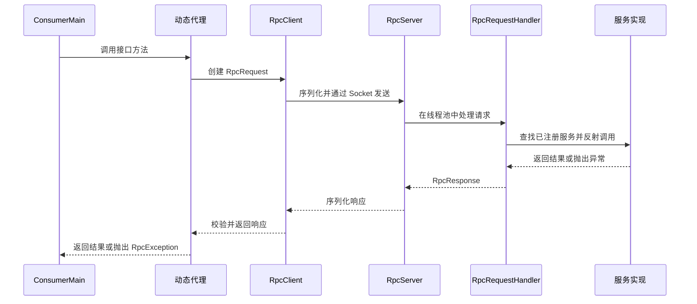

# mini-rpc

一个用于学习 RPC 原理的 Java 项目，从基础 Socket 通信开始，
逐步实现接口代理、并发处理、服务注册发现等功能。

当前第二版基于阻塞 Socket 和 JDK 序列化，实现了动态代理、
有界线程池、可配置超时和服务端资源清理。

## 技术博客

每个版本的设计思路、实现过程和问题复盘记录在对应博客中。

- 第一版：基础 Socket RPC —— https://blog.csdn.net/2604_95105375/article/details/170868895?sharetype=blogdetail&sharerId=170868895&sharerefer=PC&sharesource=2604_95105375&spm=1011.2480.3001.8118
- 第二版：动态代理、并发处理与资源清理 。

## 当前功能

- **接口代理**：通过 JDK 动态代理，将接口调用转换为远程请求。
- **网络通信**：使用 Socket / ServerSocket 发送请求和响应。
- **序列化**：使用 JDK 对象序列化传输 RpcRequest、RpcResponse。
- **服务注册**：在服务端本地注册接口及其实现对象。
- **反射调用**：按照接口名、方法名和参数类型查找并执行方法。
- **响应校验**：校验响应类型和请求 ID。
- **异常处理**：返回业务失败信息，通过 RpcException 报告调用失败。
- **并发处理**：使用有界线程池处理客户端连接。
- **超时配置**：支持配置连接超时和 Socket 读取超时。
- **资源清理**：支持关闭监听端口、已接受的连接和线程池。

## 技术栈

| 技术 | 用途 |
|---|---|
| Java 23 | 开发与运行环境 |
| Maven | 项目构建 |
| Socket / ServerSocket | 客户端与服务端通信 |
| JDK 序列化 | 请求、响应对象的传输 |
| JDK 动态代理 | 将接口调用转换为 RPC 请求 |
| Java 反射 | 服务端执行接口方法 |
| ThreadPoolExecutor | 有界线程池 |
| ConcurrentHashMap | 本地服务注册表、连接集合 |
| CountDownLatch / AtomicInteger | 并发验证与计数 |

当前版本不需要 Spring Boot、数据库或 ZooKeeper。

## 调用流程



服务端的 ServiceRegistry 是进程内的接口与实现对象映射，
尚未接入远程服务注册中心。

## 项目结构

```text
src/main/java/com/yuxiang/rpc
├── client
│   ├── RpcClient.java          # Socket 客户端
│   ├── RpcException.java       # RPC 调用异常
│   └── RpcProxyFactory.java    # 动态代理工厂
├── demo
│   ├── ConsumerMain.java       # 客户端启动入口
│   ├── HelloService.java       # 示例服务接口
│   ├── HelloServiceImpl.java   # 示例服务实现
│   └── ProviderMain.java       # 服务端启动入口
├── model
│   ├── RpcRequest.java         # 请求对象
│   └── RpcResponse.java        # 响应对象
└── server
    ├── RpcRequestHandler.java  # 请求校验与反射调用
    ├── RpcServer.java          # 连接接收、线程池与资源清理
    └── ServiceRegistry.java    # 本地服务注册表

src/test/java/com/yuxiang/rpc
└── RpcConcurrencyCheck.java    # 手动并发验证程序
```

## 快速开始

### 1. 准备环境

- JDK 23
- Maven
- IntelliJ IDEA 或其他 Java 开发工具

可以通过以下命令检查环境：

```bash
java -version
mvn -version
```

### 2. 获取项目

```bash
git clone https://github.com/saber-lab-ux/mini-rpc.git
cd mini-rpc
```

在 IDEA 中打开项目，加载 Maven 配置，并将项目 SDK 设置为 JDK 23。

### 3. 启动服务端

运行：

```text
com.yuxiang.rpc.demo.ProviderMain
```

预期输出：

```text
RPC 服务端已启动，监听 127.0.0.1:9000
```

保持服务端运行。

### 4. 启动客户端

运行：

```text
com.yuxiang.rpc.demo.ConsumerMain
```

客户端通过代理调用接口：

```java
RpcClient client = new RpcClient(
        "127.0.0.1", 9000, 3000, 5000
);

HelloService service =
        new RpcProxyFactory(client).createProxy(HelloService.class);

String result = service.sayHello("张三");
System.out.println(result);
```

现有 ConsumerMain 的预期输出：

```text
远程调用成功，返回结果：你好，张三
```

客户端与服务端是两个独立进程，调用时服务端必须保持运行。

## 配置说明

### 客户端

```java
new RpcClient("127.0.0.1", 9000, 3000, 5000);
```

| 参数 | 含义 |
|---|---|
| `127.0.0.1` | 服务端地址 |
| `9000` | 服务端端口 |
| `3000` | 连接超时，单位毫秒 |
| `5000` | Socket 读取超时，单位毫秒 |

两个参数的构造方法使用默认超时：

```java
new RpcClient("127.0.0.1", 9000);
```

默认连接超时为 3000 毫秒，读取超时为 5000 毫秒。

### 服务端

```java
new RpcServer(9000, registry, 5000);
```

最后一个参数为读取客户端数据时的超时时间，单位毫秒。

当前线程池配置写在 RpcServer 中：

| 配置 | 值 |
|---|---|
| 核心线程数 | 4 |
| 最大线程数 | 8 |
| 等待队列容量 | 32 |
| 非核心空闲线程存活时间 | 60 秒 |
| 拒绝策略 | 拒绝任务并关闭对应连接 |

## 验证方式

### 基础场景

| 场景 | 操作 | 预期结果 |
|---|---|---|
| 正常调用 | 调用 `sayHello("张三")` | 返回“你好，张三” |
| 业务异常 | 调用 `sayHello("")` | 客户端收到业务失败信息，服务端记录具体异常 |
| 异常后继续调用 | 恢复正常参数，再次调用 | 服务端仍能正常处理 |
| 连接失败 | 停止服务端后运行客户端 | 出现连接异常 |
| 读取超时 | 临时让业务等待 3 秒，客户端读取超时设置为 1 秒 | 出现 `SocketTimeoutException` |
| 关闭服务 | 触发正常的 JVM 关闭流程 | 执行资源清理并打印关闭日志 |

读取超时验证完成后，需要删除临时业务延迟并恢复超时配置。

### 并发验证

在 IDEA 中运行：

```text
com.yuxiang.rpc.RpcConcurrencyCheck
```

程序自行启动监听 9001 端口的服务端。
看到启动日志后，点击运行控制台并按回车，开始 4 个并发调用。

预期输出包含：

```text
最大同时执行业务数：4
并发验证通过：4 个请求重叠执行且结果正确
```

程序通过 CountDownLatch 协调请求，通过 AtomicInteger 统计
重叠执行的业务数量，并检查各请求的返回结果。

这是带 main 方法的手动验证程序，不会由 `mvn test` 自动执行。
它不等同于压力测试，也不覆盖线程池满载等全部边界场景。

## 当前限制

- 服务端仅监听本机 `127.0.0.1`。
- 每次 RPC 调用创建一个连接，尚未实现连接复用。
- 当前反序列化白名单主要适配字符串示例，新增类型需要同步检查。
- 尚未实现自定义报文头、心跳和协议版本管理。
- 尚未接入 ZooKeeper，也没有负载均衡、自动重试和调用监控。
- Socket 读取超时不是整个 RPC 调用的总耗时上限。
- 客户端超时不会自动取消服务端业务。
- 关闭服务会关闭已有连接，可能中断正在处理的请求。
- 线程中断不能强制终止不响应中断的业务代码。
- 当前用于本机学习演示，尚未实现认证和 TLS。

## 版本记录

- 第一版：基础 Socket RPC。
- 第二版：动态代理、并发处理、可配置超时与资源清理。

详细改动见 [CHANGELOG](CHANGELOG.md)。


## 后续计划

- 引入 Netty，设计自定义通信协议。
- 接入 ZooKeeper，实现服务注册与发现。
- 实现负载均衡，完善调用治理与监控。
- 对比不同序列化方案的报文体积与耗时。

## 许可证

当前仓库尚未添加 LICENSE 文件，授权条款待补充。